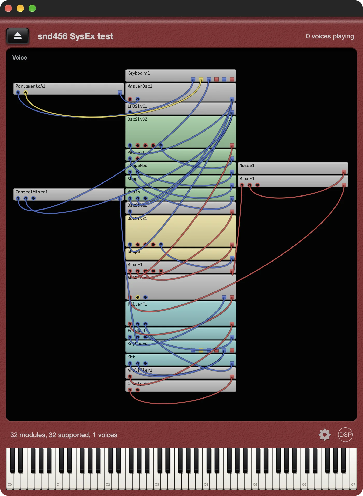

# Modubox

A standalone app and DAW plugin that plays Nord Modular G2 (`.pch2`) and Nord Modular G1 (`.pch`) patches. Each module in a patch runs as native C++ code, connected by the patch cables. Nothing is emulated and no firmware is needed.



[](https://github.com/reales/Modubox/releases)

| Platform | Formats | Download |
|---|---|---|
| macOS 12 or later (Apple silicon and Intel) | Standalone, VST3, AU | `Modubox.dmg` (signed and notarized) |
| Windows 10 or later, 64-bit | Standalone | `ModuboxWindows.zip` (signed) |
| Linux x86_64 (ALSA, X11, FreeType) | Standalone | `ModuboxLinux.zip` |

Modubox is free closed-source software by [discoDSP](https://www.discodsp.com/). This repository holds the releases and the issue tracker only.

## Beta

This is a beta. Each build stops making sound 90 days after it was built. Newer builds are posted on the [releases page](https://github.com/reales/Modubox/releases).

## First steps

1. Windows and Linux: click the gear at the bottom right and pick your audio device and MIDI input. On macOS use Options in the app menu.
2. Click the eject button at the top left and open a patch, or drop a file on the window. Modubox opens `.pch2`, `.pch`, `.syx` and `.mid` files.
3. Play from a MIDI keyboard, the on-screen keyboard or the computer keyboard: Z to M and Q to P play two octaves, comma and period move the octave down and up.
4. Hover over or click a module to highlight its cables.

In a DAW, the patch is saved with the project.

## Modules

All 165 G2 module types load: oscillators (including the DX7 operator and its 32 algorithms), envelopes, LFOs, random generators, filters, the 16-band vocoder, delays, reverb, chorus, flanger, phaser, frequency and pitch shifters, compressor, sequencers, logic, switches, mixers and MIDI input modules. G1 patches have their own module set, tuned by ear and against reference recordings.

Not supported yet: morphs, knob assignments, variation switching, the patch settings (glide, bend range, patch gain) and MIDI out. Outputs 3 and 4 are mixed into 1 and 2.

## Loading patches by SysEx

Modubox also loads a patch sent as MIDI System Exclusive to its MIDI input. Open a `.syx` or `.mid` file with the eject button, send the `.syx` with any SysEx tool, or play the `.mid` on the Modubox track.

The patch is split into messages of up to 256 bytes each:

```
F0 7D 4D 44 42 58 01 ih il ch cl <data> cs F7
```

| Bytes | Meaning |
|---|---|
| `7D` | non-commercial manufacturer ID |
| `4D 44 42 58` | `MDBX` |
| `01` | patch chunk |
| `ih il` | chunk index from 0, 14 bits (high 7 bits, low 7 bits) |
| `ch cl` | number of chunks, 14 bits |
| `data` | the chunk packed into 7-bit bytes: for each group of up to 7 bytes, one byte whose bit k is the top bit of byte k, then the 7 bytes with their top bit cleared |
| `cs` | sum of the packed data bytes, low 7 bits |

The chunks joined together hold one byte with the name length, the name (UTF-8, up to 64 bytes), then the `.pch2` or `.pch` file as is (512 KB at most). Send the chunks in order, about 20 ms apart. A chunk with a wrong checksum or out of order cancels the transfer, and the patch loads when the last chunk arrives.

## Bug reports

Open an [issue](https://github.com/reales/Modubox/issues) or write to [discoDSP support](https://www.discodsp.com/support/). Please include the patch file and what you expected to hear.

## Credits

- G2 parameter scaling uses tables from [pch2csd](https://github.com/gleb812/pch2csd) (MIT).
- Oversampling filters: [hiir](http://ldesoras.free.fr/prod.html#src_hiir) by Laurent de Soras (WTFPL).
- Nord Modular is a trademark of Clavia DMI AB. Modubox is not affiliated with Clavia.
